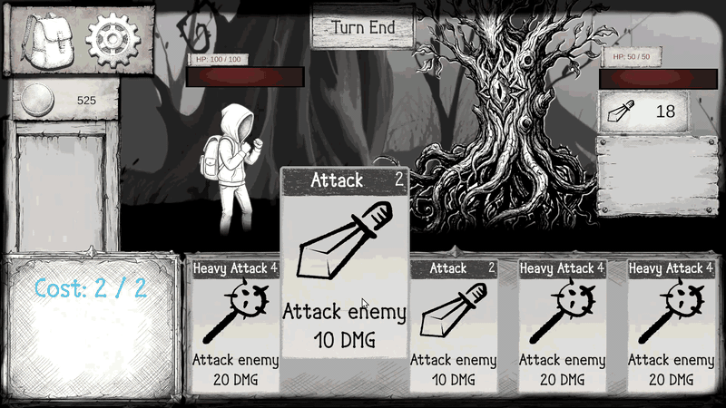
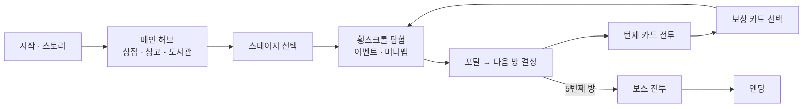

# Deck Forest — 잉크 톤 2D 카드 로그라이크

> 횡스크롤 탐험과 턴제 카드 전투를 잇는 2D 덱빌딩 로그라이크
> 목원대학교 컴퓨터융합학부 3인 팀 프로젝트 · **2026년도 제39회 컴퓨터융합학부 학술제 AI융합페스티벌 우수상** (16팀 중 5팀 수상)

<!-- 전투 GIF 자리: 카드 드래그 → 턴 종료 → 카드 투척 연출 → 적 피격 -->


| 플레이 영상 (YouTube) | 예비 영상 (저장소 내 파일) | 빌드 다운로드 |
|---|---|---|
| [YouTube 링크](URL) | [Play.mp4 (720p)](docs/video/Play.mp4) | [Releases](../../releases) |

---

## 프로젝트 개요

| 항목 | 내용 |
|---|---|
| 장르 | 2D 덱빌딩 로그라이크 (횡스크롤 탐험 + 턴제 카드 전투) |
| 개발 기간 | 약 1년 6개월 |
| 팀 구성 | 3인 (기획·클라이언트 / 클라이언트 / 디자인·그래픽) |
| 엔진 | Unity 6 (6000.2.9f1) |
| 언어 | C# |
| 주요 패키지 | UGUI, TextMeshPro, Input System 1.14, Timeline, Audio Mixer |
| AI 활용 | Gemini (코드 초안·검토), Higgsfield AI (UI·오브젝트 이미지 소스) |
| 플랫폼 | Windows (PC) |

## 팀 구성 및 역할

| 이름 | 역할 | 담당 |
|---|---|---|
| **김선우** (팀장) | 기획 · 클라이언트 | 게임 기획, UI 중심 클라이언트 개발, 전체 코드 구조 설계 및 AI 활용 코드 검증 |
| 안창민 | 클라이언트 | 클라이언트 개발 전반 |
| 김예림 | 디자인 · 그래픽 | 디자인 및 그래픽 리소스, 그래픽 관련 코드 유지보수 |

모두 목원대학교 컴퓨터융합학부입니다.

---

## 게임 플레이 루프



- **탐험**: 좌우 이동하며 선택지 이벤트(체력·골드 증감)와 필드 적을 만남
- **방 생성**: 전투 70% · 휴식 20% · 보물 10% 확률로 다음 방 예고, 5번째 방은 보스
- **전투**: 매 턴 코스트 +1(최대 10), 카드를 드래그해 사용하고 턴 종료 시 공격 연출과 함께 피해 적용
- **성장**: 승리 보상 카드, 상점 구매·뽑기, 창고에서 덱 편성

### 조작법

| 입력 | 동작 |
|---|---|
| ← → / A D | 탐험 중 이동 |
| 마우스 드래그 | 카드를 드롭 존에 놓아 사용 |
| 턴 종료 버튼 | 턴 종료 및 공격 실행 |
| P | 옵션 창 열기/닫기 |

---

## 핵심 구현

### 1. ScriptableObject 기반 데이터 구조
카드와 적을 `ScriptableObject`로 정의해 **코드 수정 없이 에셋 추가만으로 콘텐츠를 확장**할 수 있게 했습니다.

- `CardData`: 코스트, 타입(공격·방어·회복), 수치, 상태이상(취약·근력), 상점 가격 범위, 이펙트 프리팹, 타격음
- `EnemyData`: 체력, 공격·방어 수치 범위, 모션별 스프라이트, 보스 여부
- 현재 카드 11종, 적 4종(보스 1종)
- 세이브 데이터에는 카드 대신 **ID 목록**을 저장하고, 불러올 때 카드 DB에서 복원

📄 [`CardData.cs`](Assets/Script/Card/CardData.cs) · [`EnemyData.cs`](Assets/Script/NEW%20script/EnemyData.cs)

### 2. 코루틴 기반 턴제 전투
`BattleManager`가 턴 시작 → 카드 사용 → 턴 종료 연출 → 피해 계산 → 적 행동을 하나의 코루틴 흐름으로 처리합니다.

```
최종 피해 = (기본 피해 + 이번 턴 공격 카드 합 + 근력) × 1.5 (적이 취약 상태일 때)
```

- 연출 중에는 `isTurnProcessing` 플래그로 입력을 차단
- 적은 매 턴 다음 행동(공격/방어)과 수치를 **의도(Intent) 아이콘**으로 미리 표시
- 덱은 Fisher–Yates 방식으로 셔플

📄 [`BattleManager.cs`](Assets/Script/Manager/BattleManager.cs) · [`EnemyController.cs`](Assets/Script/Controller/EnemyController.cs)

### 3. 카드 UI 인터랙션
- `IBeginDragHandler` / `IDragHandler` / `IEndDragHandler`로 드래그 & 드롭 구현
- 드롭 존 위에서 놓고 코스트가 충분할 때만 사용, 아니면 원래 자리로 복귀
- 호버 시 확대·상승, 코스트 부족 카드는 회색 처리
- 같은 카드 프리팹을 **손패 · 사용 기록 · 인벤토리 · 도감** 4가지 모드로 재사용

📄 [`CardController.cs`](Assets/Script/Card/CardController.cs) · [`HandLayoutManager.cs`](Assets/Script/Manager/HandLayoutManager.cs)

### 4. 씬 간 상태 유지와 진행 구조
- `GameManager`, `StageUIManager`, `GlobalSceneFader` 등 핵심 매니저를 싱글톤 + `DontDestroyOnLoad`로 유지
- `SceneManager.sceneLoaded` 이벤트로 전투/탐험 UI 자동 전환
- `JsonUtility`로 HP·골드·덱·가방·창고·도감을 `persistentDataPath`에 저장

📄 [`GameManager.cs`](Assets/Script/Manager/GameManager.cs) · [`StageUIManager.cs`](Assets/Script/Manager/StageUIManager.cs)

### 5. 상점 · 창고 · 연출
- **상점**: 플레이어의 카드 획득 기록을 바탕으로 중복 없이 최대 3장 진열, 구매 시 골드 차감 후 저장
- **뽑기 연출**: 효과음 길이(`AudioClip.length`)를 상자 이미지 3장에 나눠 페이드 타이밍을 맞춤
- **창고**: 덱 ↔ 가방 카드 교체 시 `SmoothStep` 보간으로 위치 교환 애니메이션
- **전투 모션**: 예비동작 → 돌진 → 복귀 3단계 공격 모션, 넉백·흔들림 피격 모션 (인스펙터에서 거리·각도·시간 조절)
- **옵션**: `AudioMixer` 기반 마스터·BGM·효과음 볼륨, 해상도 설정

📄 [`StoreManager.cs`](Assets/Script/Manager/StoreManager.cs) · [`StorageManager.cs`](Assets/Script/Manager/StorageManager.cs) · [`PlayerMotionController.cs`](Assets/Script/NEW%20script/PlayerMotionController.cs)

---

## AI 활용 방식

AI가 만든 결과물을 그대로 쓰지 않고, **구조 설계 → AI 초안 → 직접 검증·수정 → AI 재검사** 순서로 통합했습니다.

1. 전체 코드 구조와 매니저 간 역할은 직접 설계
2. Gemini로 개별 기능 코드 초안 작성
3. 연동되는 스크립트와 맞는지 직접 검사하고 수정
4. 수정본을 다시 AI에게 검사받아 누락이나 오류 확인

**사례: 상점 매니저 통합**
- Gemini로 작성한 `StoreManager` 초안을 직접 검토하며, `GameManager`와 연동되는 **변수명**과 **카드 획득 기록(`collectionHistory`)을 불러오는 부분**을 프로젝트 데이터 구조에 맞게 수정
- 수정 후 상점 · 도감 · 세이브 데이터가 같은 카드 ID 체계로 연동되었고, 통합 과정에서 연동 오류가 발생하지 않음

📄 [`StoreManager.cs` — `RefreshShopItems()`](Assets/Script/Manager/StoreManager.cs)

---

## 트러블슈팅

### 카드 투척 연출에서 카드 대신 빈 하얀 사각형이 날아가는 문제
- **문제**: 턴 종료 시 사용한 카드가 적에게 날아가는 연출에서, 카드 그림 대신 빈 하얀 사각형이 표시됨
- **원인**: 투척 연출 오브젝트에 사용한 카드의 데이터(틀·그림·이름·코스트)가 세팅되지 않아 빈 `Image`만 보임
- **해결**
  - 투척 연출 전용 UI 프리팹(`uiFlyingCardPrefab`)을 따로 만들어 적용하고, `CardDisplay`로 이번 턴에 사용한 카드 데이터를 그대로 세팅
  - 카드를 사용하지 않은 턴에는 투척 연출 자체를 생략 (`playedCardsThisTurn.Count > 0`)
  - 투척 애니메이션은 3종(`CardThrow_A/B/C`) 중 무작위로 재생
- **결과**: 실제로 사용한 카드가 사용한 장수만큼 정확히 날아가도록 개선

📄 [`BattleManager.cs` — `ProcessTurnSequence()`](Assets/Script/Manager/BattleManager.cs)

### 공격·피격 모션 스프라이트가 대기 애니메이션에 덮어씌워지는 문제
- **문제**: 공격·피격 순간 바꾼 스프라이트가 곧바로 대기 모션으로 돌아가 모션이 보이지 않음
- **원인**: 플레이 화면을 직접 확인하며 추적한 결과, Animator가 매 프레임 대기 애니메이션 스프라이트를 덮어쓰고 있었음
- **해결**: 모션 코루틴이 실행되는 동안 Animator를 비활성화하고, 모션이 끝나면 원래 상태로 복구
- **결과**: 예비동작 → 돌진 → 복귀의 코드 기반 모션이 의도대로 재생

📄 [`PlayerMotionController.cs`](Assets/Script/NEW%20script/PlayerMotionController.cs)

---

## 프로젝트 구조

```
Assets/Script
├── Card/          카드 데이터 · 카드 UI 제어 · 카드 표시
├── Controller/    적 · 이동 · 포탈 · 카메라 · 미니맵 · 씬 전환
├── Manager/       게임 · 전투 · 스테이지 UI · 상점 · 창고 · 보상 · 옵션
├── Music/         BGM · 효과음
├── NEW script/    플레이어 모션 · 이벤트 · 이펙트 · 페이드
└── UI/            인벤토리 · 게임오버 · 버튼 UI
```

## 실행 방법

1. Unity **6000.2.9f1**로 프로젝트 열기
2. 아래 "사용 에셋"의 에셋스토어 패키지를 각자 계정으로 받아 `Assets/AssetStore/`에 임포트
3. `StartScene`에서 실행

빌드만 실행하려면 [Releases](../../releases)에서 Windows 빌드를 받으세요.

> 에셋스토어 라이선스상 유료·무료 에셋 원본은 저장소에 포함하지 않았습니다.

## 사용 에셋

- 2000+ Hand-drawn ink UI icons
- 23 loop animated winter trees
- Fantasy-Themed Card Pack
- Flat resource and craft icons
- Crawler - Dungeon / Crawler - Graveyard
- 2D Gothic Dungeon
- Charcoal Backgrounds
- 2D Black & White Graveyard
- Bundle Hand Painted backgrounds
- 2D Hand Painted Dark Forest
- 2D B&W Parallax Background
- Black & White Wood Asset Pack
- DotLindot Font

<!-- 에셋별 제작자와 에셋스토어 링크 추가 권장 -->

## 개선 예정

- 버림 더미와 재셔플 도입 (덱 고갈 방지)
- 카드 설명문을 수치에서 자동 생성 (설명-수치 불일치 제거)
- 피해 처리 경로 일원화 및 씬 이름 상수화
- 휴식 · 보물 방 실제 콘텐츠 연결
